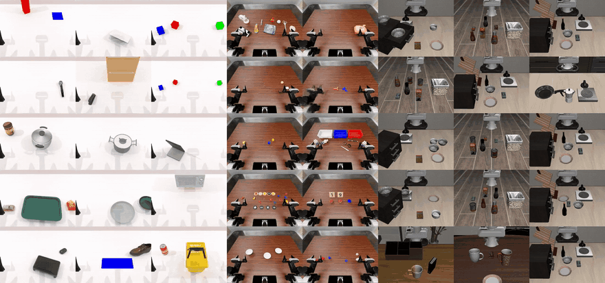

<div align="center">


# ORA: Open Robot-Use Agents

<p>
| <a href="docs/README.md"><b>Documentation</b></a>
| <a href="docs/getting-started/single-gpu.md"><b>Run on one GPU</b></a>
| <a href="docs/getting-started/local.md"><b>Run on your computer (CPU)</b></a>
| <a href="docs/quickstart.md"><b>Quickstart</b></a>
| <a href="docs/support.md"><b>Supported setups</b></a>
| <a href="CONTRIBUTING.md"><b>Contributing</b></a> |
</p>
</div>

**ORA runs a language model as a robot policy.** The model reads a robot manual, looks at camera images and public state, and moves the robot through a small set of supervised tools: perceive, plan a grasp, move, open or close the gripper. The simulator, not the model, decides whether the task succeeded.

<p align="center">

<br/><sub>One open-weight model, three simulators: LIBERO / LIBERO-Pro, RoboTwin and RoboDojo. No VLA, no robot training, no demonstrations.</sub>
</p>

## News

- `2026/10/15`: **One GPU, one command.** `ora setup --env` installs LIBERO, RoboTwin or RoboDojo on a single NVIDIA GPU without sudo or Docker, and `ora run --env … --task …` runs a task in the terminal UI. Verified end to end on an RTX PRO 6000 (Blackwell) and through the launch checks on an H200 (Hopper). See [Run ORA on one GPU](docs/getting-started/single-gpu.md).
- `2026/10/14`: **Talk to the robot agent while it works.** `ora interactive` lets you pick a benchmark task, watch the agent and send it a message mid-run; `ora local` runs a LIBERO task on your own computer with a CPU simulator.
- `2026/10/12`: **Terminal UI.** `ora watch` follows a live run or replays a finished one, the way a coding agent shows its session.

## Key features

- **A model is the policy.** Any OpenAI-compatible or Anthropic endpoint, hosted or self-hosted. The default robot profile uses DeepSeek; the agent loop talks to the model directly, with no coding-agent wrapper in between.
- **Three benchmarks, official verdicts.** LIBERO and LIBERO-Pro (Panda), RoboTwin 2.0 (dual-arm ALOHA) and RoboDojo (Isaac Sim 5.1). Success comes only from each benchmark's own evaluator.
- **Supervised tools, no privileged state.** The model sees images, depth-derived geometry and public robot state, never object ground truth, segmentation labels or the success predicate. Every action goes through a supervisor that checks and executes it.
- **Perception and planning as tools.** SAM3 segmentation, Contact-GraspNet grasp proposals and CuRobo motion planning run as local services the model calls.
- **Evidence you can replay.** Every model request and response, tool call, action and receipt is recorded and sealed. Replay any run in the terminal or browse it in the evidence viewer.
- **Runs on what you have.** One workstation or consumer GPU (Turing to Blackwell), a multi-GPU cluster, or a laptop CPU for LIBERO.

## Getting started

### Robot tasks on one GPU

On x86_64 Linux with one NVIDIA GPU (32 GB or more) and a [DeepSeek API key](https://platform.deepseek.com/):

```bash
git clone https://github.com/hao-ai-lab/ora-agent.git && cd ora-agent
uv sync --all-extras --locked
./scripts/ora setup --env robotwin                                   # once: simulator, CuRobo, perception services, UI
export DEEPSEEK_LOW_API_KEY=sk-...
./scripts/ora run --env robotwin --task click_bell --confirm-launch  # every task
```

`--env libero` (`--task libero_goal/0`) and `--env robodojo` (`--task general_pickup`) work the same way. [Run ORA on one GPU](docs/getting-started/single-gpu.md) covers requirements, GPU and driver notes, times, disk use and troubleshooting.

### A LIBERO task on your computer (CPU)

No GPU needed; macOS on Apple Silicon or Linux:

```bash
./scripts/ora setup
./scripts/ora local --confirm-launch
```

See [Run ORA on your computer](docs/getting-started/local.md). This is a reduced composition for trying ORA, not the benchmark setup.

### Check your model connection first

```bash
uv run --locked ora doctor
export ORA_API_KEY=...            # OpenAI by default; see the quickstart for other endpoints
uv run --locked ora run --env synthetic
```

A bounded episode with no simulator, model download or GPU. It checks the agent and runtime path and has no benchmark score (`official_success` is `null`). See the [quickstart](docs/quickstart.md).

### Install with an AI coding agent

If you use Claude Code, Codex, Cursor or another coding agent, give it this prompt:

```text
Install ORA (https://github.com/hao-ai-lab/ora-agent) and run one robot task.

1. Read AGENTS.md and docs/getting-started/single-gpu.md in the repository.
2. Detect the machine: run `uname -m`, `nvidia-smi` and `nvcc --version`, and check
   the tools listed in the guide's section 2. With no NVIDIA GPU, follow
   docs/getting-started/local.md instead.
3. Follow the guide exactly: `./scripts/ora setup --env robotwin`, then
   `./scripts/ora run --env robotwin --task click_bell --confirm-launch`.
   I will provide DEEPSEEK_LOW_API_KEY in the shell; never print, store or commit it.
4. If a step fails, find the matching row in the guide's troubleshooting table,
   fix it, and tell me what you changed.
5. Report the run ID and its official_success.
```

## Watch and steer runs in the terminal

<p align="center">

<br/><sub>Replay of a sealed RoboDojo run (stack the blocks by language), motion sped up.</sub>
</p>

ORA shows a run the way a coding agent shows a session: the instruction, what the model says, each tool call with its condensed result, action receipts, the official verdict, and a footer with round, context and token use.

```bash
./scripts/ora watch RUN_ID                               # follow a live run or replay a finished one
./scripts/ora interactive --spec SPEC --confirm-launch   # pick a task and steer it while it runs
```

`ora watch` is read-only. In `ora interactive`, `ora local` and `ora run`, Enter sends the running agent a message, Alt+Enter queues one for the next task, Esc stops the run and Ctrl-C leaves it running. Runs you steer are marked human-assisted and are not counted as autonomous. Without Node, `ora watch` falls back to a built-in text view. See [run and inspect](docs/usage/runs.md) and [interactive sessions](docs/usage/interactive.md).

## Environments

| Environment | Robots and tasks | Verdict | Install and run |
|---|---|---|---|
| LIBERO / LIBERO-Pro | Panda; LIBERO suites and source-paired robustness variants | Official LIBERO termination | [one GPU](docs/getting-started/single-gpu.md) · [explicit setup](docs/environments/libero.md) |
| RoboTwin 2.0 | Dual-arm ALOHA; 50 tasks, clean and randomized scenes | Official `check_success` | [one GPU](docs/getting-started/single-gpu.md) · [explicit setup](docs/environments/robotwin.md) |
| RoboDojo | ARX in Isaac Sim 5.1 | Official task success | [one GPU](docs/getting-started/single-gpu.md) · [explicit setup](docs/environments/robodojo.md) |

Each simulator has its own interpreter; Torch, simulator packages, robot assets and perception weights are installed separately from ORA's locked Python environment. See the [support matrix](docs/support.md) for the tested configurations.

## How it works

The Native agent connects directly to your model API. Prompt bundles deliver the task, the robot manual and the tool contracts. Tools expose observations and bounded action proposals; the Supervisor checks and dispatches each action. The simulator supplies the task verdict. ORA records requests, responses, actions and receipts for inspection and export.

[Architecture](docs/architecture.md) · [Current interfaces](docs/reference/README.md) · [Evidence viewer](viewer/README.md)

There are no managed coding-agent adapters, VLA services or cross-episode Task Memory in this distribution. Recoverable context artifacts retain large tool results within an episode.

## Develop

```bash
uv sync --all-extras --locked
uv run --locked python -m pytest tests
./scripts/ora lock --check
```

The distribution is named `ora-agent`; the Python import and command are `ora`. Use a source checkout for launches so plans can bind a clean Git commit. A PyPI release and the accompanying blog are pending.

Preview the searchable documentation site with `./scripts/docs serve` and open `http://127.0.0.1:8000/`. Build and validate its static output with `./scripts/docs build`. See the [documentation guide](docs/developer/documentation.md).

Licensed under [Apache-2.0](LICENSE). Bundled third-party code retains the notices in [NOTICE](NOTICE).
