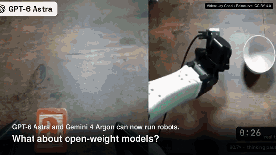
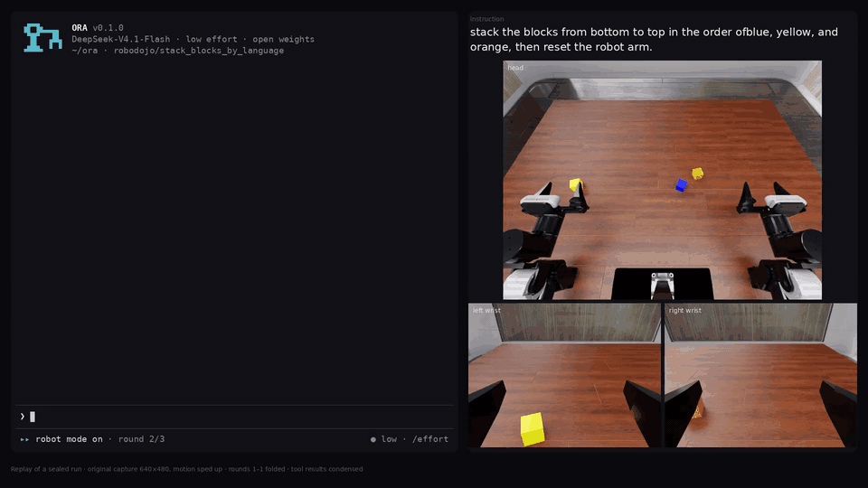

<div align="center">


# ORA: Open Robot-Use Agents

<p>
| <a href="docs/README.md"><b>Documentation</b></a>
| <a href="#getting-started"><b>Getting started</b></a>
| <a href="docs/getting-started/single-gpu.md"><b>One-GPU guide</b></a>
| <a href="docs/getting-started/local.md"><b>CPU guide</b></a>
| <a href="docs/support.md"><b>Supported setups</b></a>
| <a href="CONTRIBUTING.md"><b>Contributing</b></a> |
</p>
</div>

**ORA turns a language model into a robot policy.** The model reads a robot manual, looks at the cameras and the robot's public state, and works the task through a small set of supervised tools: find objects, plan a grasp, move, open or close the gripper. It never sees the simulator's ground truth, and only the benchmark's own evaluator decides whether the task succeeded.

<p align="center">
<a href="docs/assets/videos/ora-teaser.mp4"></a>
<br/><sub>Teaser (click for the full video). Open-weight DeepSeek through ORA, zero-shot: no VLA, no robot training, no demonstrations.</sub>
</p>

## What is in this repository

- **The agent.** A direct loop between your model API (OpenAI-compatible or Anthropic, hosted or self-hosted) and the robot. Prompt bundles give the model the task, the robot manual and the tool contracts; long tool results stay recoverable within an episode.
- **Robot tools and a supervisor.** Perception (SAM3 segmentation, depth geometry), grasp proposals (Contact-GraspNet) and motion planning (CuRobo) are tools the model calls. Every action is checked and executed by a supervisor; the model cannot bypass it.
- **Three benchmarks.** LIBERO / LIBERO-Pro (Panda), RoboTwin 2.0 (dual-arm ALOHA) and RoboDojo (ARX, Isaac Sim 5.1), each in its own isolated interpreter, with each benchmark's official success check.
- **Evidence.** Every model request and response, tool call, action and receipt is recorded and sealed. Replay a run in the terminal with `ora watch` or browse it in the evidence viewer.
- **A terminal UI.** Watch the agent work the way you watch a coding agent, and send it a message while it runs.

## News

- `2026/10/15`: ORA is released. Open-weight models run LIBERO, RoboTwin and RoboDojo tasks through ORA's tools, from one command on one GPU, with a terminal UI to watch and steer them.

## Getting started

### Pick your machine

| Your machine | What runs | Start with | Verified on |
|---|---|---|---|
| Laptop or desktop without an NVIDIA GPU (macOS on Apple Silicon, or Linux) | LIBERO on a CPU simulator, reduced tool set | `./scripts/ora setup` → `./scripts/ora local --confirm-launch` · [CPU guide](docs/getting-started/local.md) | Linux x86_64 (one LIBERO task solved); macOS supported, not yet verified |
| Linux with one NVIDIA GPU, 32 GB or more (Turing to Blackwell) | LIBERO / LIBERO-Pro, RoboTwin and RoboDojo, full tool set | `./scripts/ora setup --env <env>` → `./scripts/ora run --env <env> --task <task> --confirm-launch` · [one-GPU guide](docs/getting-started/single-gpu.md) | RTX PRO 6000 Blackwell (all three, end to end); H200 (through launch checks) |
| Multi-GPU cluster | Official suites at benchmark scale, many runs in parallel | [Benchmark setup and official suites](docs/guides/official-suite-getting-started.md) | 8× H200 nodes |

Every path needs Git, [uv](https://docs.astral.sh/uv/getting-started/installation/) and a model API key; the terminal UI needs Node.js 20 or newer. ORA itself installs into one locked Python 3.11 environment:

```bash
git clone https://github.com/hao-ai-lab/ORA.git && cd ORA
uv sync --all-extras --locked
```

### Pick an environment

Each environment has its own getting-started guide: what it is, what to install, how to run the first task, which tasks exist and what a first run looks like.

| Environment | Install once | Run a task | Guide |
|---|---|---|---|
| **LIBERO / LIBERO-Pro** (Panda) | `./scripts/ora setup --env libero` | `./scripts/ora run --env libero --task libero_goal/0 --confirm-launch` | [Get started with LIBERO](docs/getting-started/libero.md) |
| **RoboTwin 2.0** (dual-arm ALOHA) | `./scripts/ora setup --env robotwin` | `./scripts/ora run --env robotwin --task click_bell --confirm-launch` | [Get started with RoboTwin](docs/getting-started/robotwin.md) |
| **RoboDojo** (ARX, Isaac Sim 5.1) | `./scripts/ora setup --env robodojo` | `./scripts/ora run --env robodojo --task general_pickup --confirm-launch` | [Get started with RoboDojo](docs/getting-started/robodojo.md) |
| **LIBERO without a GPU** | `./scripts/ora setup` | `./scripts/ora local --confirm-launch` | [Run ORA on your computer](docs/getting-started/local.md) |

Set your key before running: `export DEEPSEEK_LOW_API_KEY=sk-...`. ORA reads it from the environment and never stores it. The [one-GPU guide](docs/getting-started/single-gpu.md) covers the tools to install first, GPU and driver notes, disk and GPU memory, running over SSH and troubleshooting.

### Check your model connection first

```bash
uv run --locked ora doctor
export ORA_API_KEY=...                    # OpenAI by default; the quickstart covers other endpoints
uv run --locked ora run --env synthetic
```

A bounded episode with no simulator, model download or GPU. It checks the agent and runtime path and has no benchmark score. See the [quickstart](docs/quickstart.md) and [model APIs](docs/getting-started/model-apis.md).

### Install with an AI coding agent

If you use Claude Code, Codex, Cursor or another coding agent, give it this prompt:

```text
Install ORA (https://github.com/hao-ai-lab/ORA) and run one robot task.

1. Read the "Getting started" section of README.md and the guide for the
   environment you will run (docs/getting-started/robotwin.md here).
2. Detect the machine: run `uname -m`, `nvidia-smi` and `nvcc --version`.
   With an NVIDIA GPU of 32 GB or more, follow docs/getting-started/single-gpu.md;
   otherwise follow docs/getting-started/local.md.
3. Follow the guide exactly. On a GPU: `./scripts/ora setup --env robotwin`, then
   `./scripts/ora run --env robotwin --task click_bell --confirm-launch`.
   I will provide DEEPSEEK_LOW_API_KEY in the shell; never print, store or commit it.
4. If a step fails, find the matching row in the guide's troubleshooting table,
   fix it, and tell me what you changed.
5. Report the run ID and its official_success.
```

## Watch and steer runs in the terminal

<p align="center">

<br/><sub>Replay of a sealed RoboDojo run (stack the blocks by language), motion sped up.</sub>
</p>

ORA shows a run the way a coding agent shows a session: the instruction, what the model says, each tool call with its condensed result, action receipts, the official verdict, and a footer with round, context and token use.

```bash
./scripts/ora watch RUN_ID                               # follow a live run or replay a finished one
./scripts/ora interactive --spec SPEC --confirm-launch   # pick a prepared task and steer it while it runs
./scripts/open-viewer                                    # browse runs, videos and trajectories in the browser
```

`ora watch` is read-only. In `ora interactive`, `ora local` and `ora run`, Enter sends the running agent a message, Alt+Enter queues one for the next task, Esc stops the run and Ctrl-C leaves it running. Runs you steer are marked human-assisted and are not counted as autonomous. See [run and inspect](docs/usage/runs.md) and [interactive sessions](docs/usage/interactive.md).

## How it works

The Native agent connects directly to your model API. Prompt bundles deliver the task, the robot manual and the tool contracts. Tools expose observations and bounded action proposals; the Supervisor checks and dispatches each action. The simulator supplies the task verdict. ORA records requests, responses, actions and receipts for inspection and export.

[Architecture](docs/architecture.md) · [Current interfaces](docs/reference/README.md) · [Environments](docs/environments/README.md) · [Evidence viewer](viewer/README.md)

## Develop

```bash
uv sync --all-extras --locked
uv run --locked python -m pytest tests
./scripts/ora lock --check
./scripts/docs serve                      # documentation site at http://127.0.0.1:8000/
```

The distribution is named `ora-agent`; the Python import and command are `ora`. Use a source checkout for launches so plans can bind a clean Git commit. A PyPI release and the accompanying blog are pending. See [contributing](CONTRIBUTING.md) and the [documentation guide](docs/developer/documentation.md).

Licensed under [Apache-2.0](LICENSE). Bundled third-party code retains the notices in [NOTICE](NOTICE).
