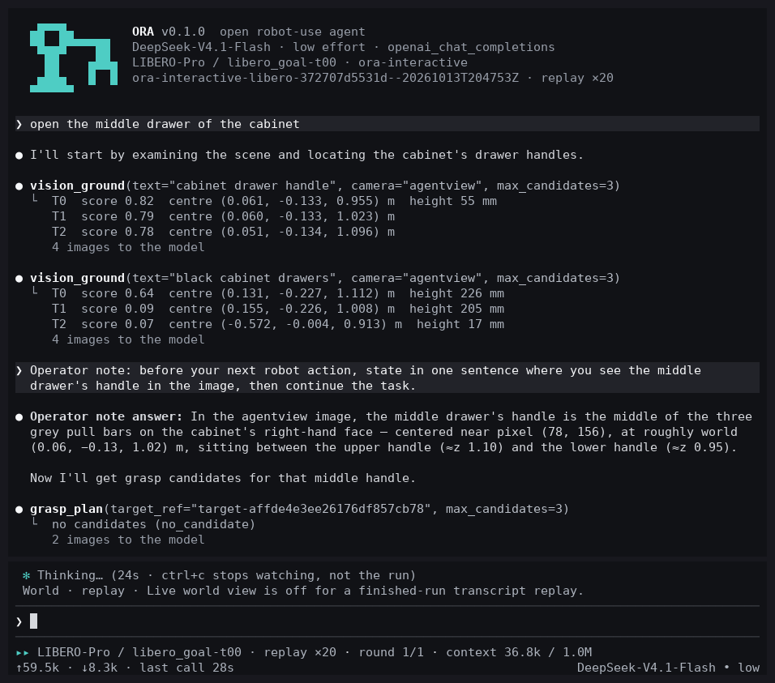

# ORA: Open Robot-Use Agents

ORA runs a language model as a robot policy: it reads a manual, inspects public observations, and proposes actions through a supervised tool interface.

[Documentation](docs/README.md) · [Quickstart](docs/quickstart.md) · [Supported environments](docs/support.md) · [Contributing](CONTRIBUTING.md)

## Try it

Install [uv](https://docs.astral.sh/uv/getting-started/installation/), then:

```bash
git clone https://github.com/hao-ai-lab/ora-agent.git && cd ora-agent
uv sync --all-extras --locked
uv run --locked ora doctor
```

Set `ORA_API_KEY` in your shell, then run:

```bash
uv run --locked ora run --env synthetic
```

This calls a real model API and saves a sealed episode under `outputs/quickstart/runs/`. It needs no simulator, model download or GPU. The default endpoint is OpenAI Chat Completions with `gpt-4.1-mini`; [the quickstart](docs/quickstart.md) explains other OpenAI-compatible and Anthropic endpoints, including self-hosted models. API usage is billed by your provider.

Synthetic checks the agent/runtime connection. It has no manipulation benchmark score: `official_success` is `null`.

## Run robot tasks on one GPU

With one NVIDIA GPU (32 GB or more, x86_64 Linux) and a DeepSeek API key, two commands install an environment and run a task in it, with the terminal UI below:

```bash
./scripts/ora setup --env robotwin                                   # once: simulator, CuRobo, perception services, UI
export DEEPSEEK_LOW_API_KEY=sk-...
./scripts/ora run --env robotwin --task click_bell --confirm-launch  # every task
```

`--env libero` (`--task libero_goal/0`) and `--env robodojo` (`--task general_pickup`) work the same way. No sudo, Docker or gated download is needed. Follow [Run ORA on one GPU](docs/getting-started/single-gpu.md) for requirements, GPU and driver notes, times and troubleshooting.

## Run on your computer (CPU)

To see ORA work a real LIBERO task on your own computer without a GPU, follow [Run ORA on your computer (CPU)](docs/getting-started/local.md): `./scripts/ora setup`, then `./scripts/ora local --confirm-launch`. You can steer the run from the terminal while it works ([interactive sessions](docs/usage/interactive.md)).

## Terminal UI



ORA shows a run the way a coding agent shows a session: the instruction, what the model says, each tool call with its condensed result, action receipts, the official verdict, and a footer with round, context and token use.

```bash
npm ci --prefix ora-tui                    # once; needs Node.js 20+ (`ora setup` does this for `ora local`)
./scripts/ora watch RUN_ID                 # follow a live run or replay a finished one
./scripts/ora interactive --spec SPEC --confirm-launch   # pick a task and steer it while it runs
./scripts/ora local --confirm-launch       # a LIBERO task on your own computer (CPU)
```

`ora watch` is read-only. In `ora interactive` and `ora local`, Enter sends the running agent a message, Alt+Enter queues one for the next task, Esc stops the run and Ctrl-C leaves it running; runs you steer are marked human-assisted. Without Node, `ora watch` falls back to a built-in text view. See [run and inspect](docs/usage/runs.md) and [interactive sessions](docs/usage/interactive.md).

## Choose an environment

On one GPU, `ora setup --env` / `ora run --env` ([guide](docs/getting-started/single-gpu.md)) install and run all three. The per-environment pages below cover the explicit installation and multi-GPU hosts.

| Environment | Install and run | Verdict |
|---|---|---|
| LIBERO / LIBERO-Pro | [Panda installation and one episode](docs/environments/libero.md) | Official LIBERO termination |
| RoboTwin | [Dual-arm installation and one episode](docs/environments/robotwin.md) | Official `check_success` |
| RoboDojo | [Isaac installation and one episode](docs/environments/robodojo.md) | Official task success |

Each simulator has its own interpreter. Torch, simulator packages, robot assets and perception weights are installed separately from ORA's locked Python environment. See the [support matrix](docs/support.md) for the tested configurations.

## How it works

The Native agent connects directly to your model API. Prompt bundles deliver the task, robot manual and tool contracts. Tools expose observations and bounded action proposals; the Supervisor checks and dispatches each mutation. The simulator supplies the task verdict. ORA records requests, responses, actions and receipts for inspection and export.

[Architecture](docs/architecture.md) · [Current interfaces](docs/reference/README.md) · [Evidence viewer](viewer/README.md)

There are no managed coding-agent adapters, VLA services or cross-episode Task Memory in this distribution. Recoverable context artifacts retain large tool results within an episode.

## Develop

```bash
uv sync --all-extras --locked
uv run --locked python -m pytest tests
./scripts/ora lock --check
```

The distribution is named `ora-agent`; the Python import and command are `ora`. Use a source checkout for launches so plans can bind a clean Git commit. A PyPI release and the accompanying blog are pending.

Preview the searchable documentation site with `./scripts/docs serve` and open
`http://127.0.0.1:8000/`. Build and validate its static output with
`./scripts/docs build`. See the [documentation guide](docs/developer/documentation.md).

To install with a coding agent, give it this instruction:

> Read AGENTS.md and docs/quickstart.md. Install the locked ORA environment, run ora doctor, and help me configure my existing model API without printing or committing credentials. Run the Synthetic quickstart before installing a simulator.

Licensed under [Apache-2.0](LICENSE). Bundled third-party code retains the notices in [NOTICE](NOTICE).
