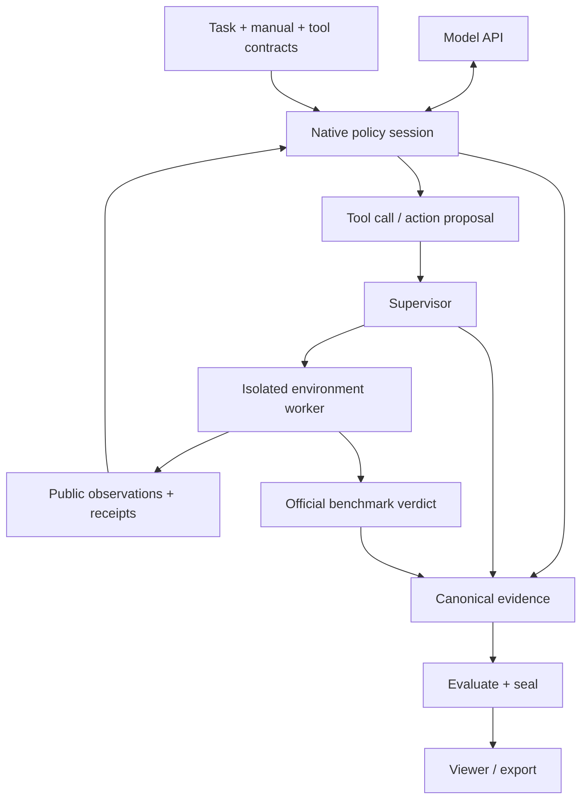

# Architecture

ORA has two loops: a Native policy decides what to try; the trusted runtime decides whether and how an action may execute.

The agent can inspect public observations and propose actions. It cannot mutate simulator state directly, inspect privileged task state or set the official verdict. Read-only geometry/perception tools produce evidence; mutation tools submit versioned proposals to the Supervisor. Motion planning and simulator stepping remain behind the environment boundary.

The worker runs in the simulator's interpreter over `local_rpc`. Simulator imports stay out of the host-safe resolver, benchmark catalogs and contracts. Synthetic uses an in-process environment for infrastructure checks.

A RunSpec supplies task, provider, resources and budgets. Resolution selects a default baseline when applicable, binds policy assets and source identity, and produces a content-addressed RunPlan. Preflight checks fresh dependencies and admission before a resource lease is claimed. The supervisor executes the exact plan and attempts evaluation/sealing at landing.

Native context assembly preserves the task, tool contract and current public state while managing tool history and recoverable artifacts. Context artifacts are episode evidence; they are not cross-episode Task Memory.

[Runtime lifecycle](reference/runtime-lifecycle.md) · [Interfaces](reference/public-interfaces.md) · [Configuration and evidence](reference/configuration-and-evidence.md)
