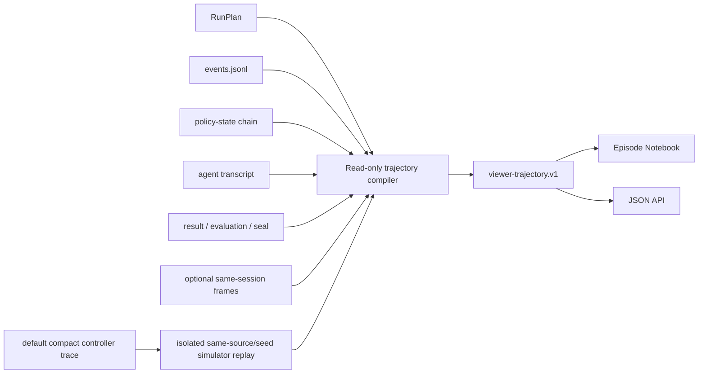

# Viewer, LIBERO Atlas and RoboTwin Gallery

Family navigation is available at `/experiments` and `/experiments/<family>`; the main registry filters family and full generation ID and preserves source/run identities. `/api/experiments/<family>` exposes the same projection. A run relabeled by reviewed migration shows its recorded generation beside the new one, and the recorded family's page counts the runs it shows under another family. See [experiment identity](../docs/reference/experiment-identity.md).

The registry is a local, read-only Flask application for Runtime evidence,
experiment task sheets, the pinned LIBERO/LIBERO-Pro atlas, and the pinned
RoboTwin task catalog. ORA also uses a small exact-run world-view service for
live execution capture. Neither service writes run artifacts or contacts a
simulator.

For original capture, diagnostic reconstruction, cache verification and new
backend integration, use the shared [trajectory-to-Viewer procedure](../docs/guides/trajectory-capture-and-viewer.md).
Reuse the listed modules instead of adding a per-experiment video pipeline.

## Shared frontend template

Every page uses the same minimal light shell: system fonts, compact controls,
thin borders and unfiltered media. Open `/style-guide` for a small example.
`viewer/templates/base.html` and `viewer/static/base.css` own the reusable
shell and defaults; `viewer/static/viewer.css` owns component layout. See the
[frontend style guide](../docs/guides/frontend-style.md) before adding a page.
The installed package includes these HTML and CSS assets.

## ORA live world view

`viewer/live_world.py` supplies ORA's loopback-only companion window. A human
terminal running `ora interactive` opens it in a waiting state before task
selection; a live `ora watch RUN` binds it to that exact run. The service
follows original execution-capture PNG frames and the complete prefix of the
append-only capture timeline. It takes no Runtime lease and starts no model
or simulator. Browser acknowledgements affect only its ephemeral connection
state, not run evidence or official outcomes.

The view distinguishes waiting, holding, executing, capture-behind, error and
disconnected states. A connection becomes confirmed only after the browser
decodes and acknowledges an image for the bound run. A last captured frame
can remain on screen while capture catches up; the status preserves that
distinction. A sealed transcript replay does not automatically open this live
view because its replay clock differs from the latest captured frame.

The CLI defaults to `--world-view auto --world-port 0 --world-browser auto`
for human sessions. `--world-view off` selects terminal-only use;
`--world-browser off` leaves the service available without browser launch.
JSON-lines clients are headless unless they explicitly request a world port
or public URL. For a remote simulation host, `scripts/ora-remote` provides the
loopback tunnel and opens the browser on the operator's local computer. Local
execution remains subject to the supplied task's host and simulator
qualifications; a full Mac CPU/MuJoCo preset is not yet qualified. See the
[run guide](../docs/usage/runs.md#follow-one-run) and
[public interfaces](../docs/reference/public-interfaces.md#operator-and-composition).

## Start the viewer

From the repository root:

```bash
./scripts/open-viewer
./scripts/open-viewer --page libero
```

The script selects `.venv` or the locked `uv` environment, starts the Viewer at
<http://127.0.0.1:5012>, and opens the default browser. Stop it with `Ctrl-C`.
The default `runs` page is the evidence registry. `--page libero` opens the
integrated LIBERO/LIBERO-Pro atlas directly (`libero-pro` remains an alias);
`--page robotwin` opens the
RoboTwin catalog. These are allowlisted start pages for the same read-only
process, not separate Viewer implementations.

The default page is also the global experiment index: evidence class, backend,
experiment ID, task, seed, lifecycle state and official outcome are composable
filters. Backend names are rendered as RoboTwin and LIBERO/LIBERO-Pro rather
than leaking only adapter identifiers. A scoped experiment page links back to
this registry and never becomes a second evidence index.

Opening the field guide never starts LIBERO or MuJoCo. It reads the current
preview manifest and shows explicit placeholders when images are unavailable.
Check or build the independently generated seed-0 preview cache with:

```bash
./scripts/dev/compile-libero-previews --status
./scripts/dev/compile-libero-previews  # only on the pinned LIBERO-Pro host
```

Validate every optional, tracked experiment view without starting the server:

```bash
uv run --locked python -m viewer.app --audit-experiment-views
```

An experiment may declare `experiments/<experiment>/viewer.yaml` with schema
`ora.viewer-experiment.v1`. The four fixed layouts are
`single_episode`, `matrix`, `persistent_rounds` and `diagnostic_set`. The
manifest references `experiment.yaml.accepted_evidence` keys; run identity,
verdicts, metrics, videos and cost remain derived from immutable local evidence.
Experiments without a manifest keep the generic run ledger.

Any accepted run that contains persistent-session `rounds` evidence shows its
per-round official verdict and a direct link to that round's first recorded
ActionStep, regardless of the surrounding gallery layout. This lets a
heterogeneous `diagnostic_set` keep five tasks separate while exposing every
round's model chat and actions through the same Episode Notebook. The gallery
summary never synthesizes a top-level official verdict for a persistent
session.

To start without opening a browser, use:

```bash
uv run --locked python viewer/app.py
```

Both launch forms accept `--host`, `--port` and `--page`. The default bind is
intentionally local-only; change it only when the surrounding network boundary
is controlled. `--page` only selects the browser URL and does not change which
read-only routes the server exposes.

The shared `outputs/` root is discovered automatically from Git's common
checkout, so starting the Viewer from any linked worktree shows the same new
runs. It also discovers live linked-worktree output roots and recursively reads
legacy `worktree-snapshots` collections. Use
`ORA_WORKSPACE_ROOT=/absolute/path` to place both shared `outputs/`
and `.harness-runtime/` outside the primary checkout; use the same value for
every launcher and Viewer process on that machine.

To inspect copied output collections in addition to automatic discovery, set
the path-separated `ORA_EXTRA_OUTPUT_ROOTS`. To replace automatic
discovery with an explicit collection or experiment workspace, repeat
`--outputs-root` as needed:

```bash
uv run --locked python viewer/app.py \
  --outputs-root /path/to/outputs \
  --outputs-root /path/to/another-experiment-workspace
```

Each target may be an outputs root containing nested `*/runs/*`, an experiment
workspace containing `runs/*`, or one exact run root containing `plan.json`.
Run IDs must remain unique across all configured roots. The Viewer header shows
the shared evidence destination and every active discovery root.

The run index and cost list read registration metadata without projecting full
trajectories to inspect video caches. The index labels video availability
`check in run`; opening an exact run checks its source-bound media. An omitted
cache check is not displayed as a missing video.
For discovery and subsequent registration reuse,
the recursive run-root scan is reused for five seconds after completion per
configured root set, and each run's registration is reused while an evidence fingerprint —
the exact stat identity of its plan/status/result/launch/evaluation/seal/event
files plus the derived-video directory listing — is unchanged. A newly landed
or re-derived run therefore appears within one refresh without re-reading
every sealed run on every filter click.

## Round Results and Process Videos

Experiment and LIBERO task-cohort pages show a round matrix automatically when
their visible runs contain session rounds. Each row identifies one exact run,
task, seed, config and source. Cells distinguish official success/failure,
running, incomplete, unscored and unrun rounds. The summary reports scored and
completed counts plus the first recorded success; persistent rounds retain
their session relationship and do not become independent Pass@K trials.
Experiment and task pages select RunPlan identities before registering traces
from the selected scope. They omit expensive video-availability inspection,
which is represented as uninspected and cached separately from full registry
rows. Opening a video still performs media verification.

The Episode Notebook opens with an **Execution / Full process** player. Choose
a round or a recorded chapter to seek the video; playback highlights its
ActionStep, and the Notebook outline seeks back to that step. Switching video
versions preserves the event/action position. A round can play within a cached
full video and stops at its boundary. **Export full MP4** labels that fallback;
a separate round export requires its own offline compile.

Full process follows recorded observations, model responses, grounding/grasp
results, execution clips, receipts and official round outcomes. Native
`tool_image` artifacts are hash-verified, including older segmentation returns.
Repeated calls retain their identities and recorded order. Managed summaries
declare incomplete ordering. The inspector links to original events and shows
complete recorded reasoning in a collapsed panel. **Reasoning excerpts** and
**Context** select additional video content; they never reconstruct
unrecorded model reasoning.

Compile an optional version explicitly, using an exact discovered run ID:

```bash
./scripts/dev/compile-viewer-videos --run-id RUN_ID --video-mode process
./scripts/dev/compile-viewer-videos --run-id RUN_ID --video-mode process \
  --round 2 --include-reasoning --include-context
./scripts/dev/compile-viewer-videos --run-id RUN_ID --video-mode execution --round 2
```

`--round` is one-based. Omit it for all recorded rounds; `--run-id` may repeat
and selects exact runs independently of the default batch evidence filter.
Exact IDs are resolved before trace registration; duplicate IDs across output
roots are rejected.
`--card-seconds` accepts 0.5–15 seconds (default 2.5); observation and receipt
cards have shorter caps. Text uses labelled excerpts and images paginate in
groups of four. The web player uses the default card duration. The existing
`--replay-mode review|forensic` selects execution sampling independently of
`--video-mode execution|process`.

Process compilation uses CPU-only Pillow/FFmpeg and verified existing MP4 plus
timeline pairs. It does not launch a simulator, provider or perception service.
Without compatible execution media, it makes a labelled observation-boundary
presentation. Exact execution compiles retain the existing offline replay
prerequisites. The web process only serves presentation caches and returns a
compile command when a selected version is missing. Generated MP4s and chapter
manifests stay under `viewer-derived`, outside the sealed run and Git.
Reading time is edited presentation time, with recorded latency preserved
separately.

## Page inventory

| Route | Purpose | Evidence status |
|---|---|---|
| `/` | Index runs newest-first with explicit UTC date/time, experiment ID, config, exact run ID, official behavioral verdict, independent control-validity classification and direct review links. Formal, Behavioral, Qualifications, Diagnostics and All are separate views; experiment, backend, exact LIBERO task and seed filters compose. | Formal means non-Synthetic `behavioral` evidence that is completed, evaluator-valid and sealed; filtering never changes evidence. Control validity is an audit of action/receipt integrity and never replaces the official task verdict. |
| `/costs` | Aggregate formal or all behavioral LIBERO runs by exact task and run, with provider input/cache-read/output tokens, Context Compactor usage and a versioned official API list-price estimate. Qualification and diagnostic probes are excluded. | Sealed rows use `runtime-metrics.json`; live Native rows are explicitly provisional. This is a list-price equivalent, not an account invoice, and never modifies run evidence. |
| `/experiment/<experiment_id>/runs` | Compare every locally indexed run belonging to one experiment, with date, config, task, seed, evidence type, outcome and direct summary/raw/evidence links. An experiment with a versioned `viewer.yaml` first shows its accepted cells through one of four fixed layouts plus epistemically labelled findings. | Registration, outcomes, source identities, metrics, videos and notebooks are derived from exact run evidence; no second run registry is maintained. Review order and prose are tracked archive claims, source mismatch is prominent, and excluded infrastructure attempts remain outside the accepted comparison. |
| `/task/libero_pro/<suite>/<task_id>/runs` | Review one exact LIBERO task across every locally indexed experiment/source condition, with completed/formal/all-behavioral views plus seed and outcome filters. Each visible run also projects average/P95/peak request context, images per request, token-weighted cache read and the exact context policy from its deterministic Runtime report. | Identity is the recorded `runtime.kind + suite + task_id`, not experiment naming or instruction text. The page labels non-formal attempts, preserves missing telemetry, and warns that heterogeneous treatments or provider measurement surfaces must not be pooled into a causal success rate. |
| `/experiment/<experiment_id>/configs` | Read the tracked `experiment.yaml` cell catalog and jump from each config to its newest locally indexed exact composition. Packages that register `inspect-config` also show the non-launching prospective command. | This is a static source declaration, not proof of what a provider received. Recorded RunPlan/context evidence remains authoritative. |
| `/run/<run_id>` | Read the complete episode as a continuous lab notebook: separate behavioral and control-validity stamps, sticky ActionStep outline, large visibility-labelled observations, recorded model responses, ordered execution details, action/receipt pairs and collapsed post-action frames. Persistent K-session results add one AgentSession ledger, per-round official verdicts and Supervisor-reset boundaries; an optional exact-source `viewer-analysis.json` adds curated incident navigation. | Read-only derived projection over exact run evidence. K-session round success is never collapsed into a synthetic top-level official verdict; control validity and curated incident labels remain separate presentation/analysis and never change canonical or sealed artifacts. |
| `/run/<run_id>/composition` | Inspect provider-request slot order, exact recorded prompt text, dynamic/opaque slot status, source files and hashes, and every advertised tool description/schema/effect. | Schema-backed read-only projection of the run's RunPlan, context manifest, compiled policy and ToolSurface. Managed context is labelled opaque rather than reconstructed. |
| `/api/run/<run_id>/composition` | Return the same exact configuration inspection as JSON. | Schema `ora.policy-config-inspection.v1`; it never calls a provider or environment. |
| `/api/run/<run_id>/trajectory` | Return the deterministic trajectory bundle used by the Episode Notebook. Persistent K-sessions add a bounded `session_rounds` object and round-local identity on each covered ActionStep. | Schema `ora.viewer-trajectory.v1`, with optional nested `ora.viewer-session-rounds.v1` and source-artifact hashes. |
| `/api/run/<run_id>/process` | Return ordered process chapters, round ledger, source addresses, tool images, model text, coverage and unplaced events. | Schema `ora.viewer-process-timeline.v1`; a read-only projection, with partial ordering labelled. |
| `/api/run/<run_id>/presentation-video` | Return frame/second chapter ranges for the selected cached presentation. | Schema `ora.viewer-presentation-video.v1`; accepts `video_mode`, one-based `round`, `reasoning=0|1`, `context=0|1`, `card_seconds` and `replay_mode`. Missing media returns HTTP 503 with `compile_hint`; invalid options return 400. |
| `/run/<run_id>/presentation.mp4` | Stream or export the same selected presentation, with HTTP range support. | Same options and read-only cache boundary as presentation metadata. No encoder or replay starts from this route. |
| `/api/run/<run_id>/cost` | Return one run's token categories, price snapshot, component costs and total list-price estimate as JSON. | Schema `ora.viewer-provider-cost-estimate.v1`; missing cache telemetry or an unregistered model fails closed instead of assuming a price. |
| `/run/<run_id>/trajectory/raw` | Review every original Runtime, Agent and transcript JSONL record in one searchable three-pane viewer: immutable source-event rail, exact selected payload, and synchronized actual-observation context. Multi-round and analyzed runs add round filtering, point/Mask, control, Context and task-check review lenses, plus incident chains that jump to the underlying cycle. | The center pane is always the original source line. Filters, incident colors and right-side explanations are labelled navigation/analysis projections. |
| `/api/run/<run_id>/trajectory/raw` | Return the compact raw-event index, source identities and synchronized observation-cycle index. | Schema `ora.viewer-raw-trajectory.v1`; it does not copy full event payloads or create a new canonical event order. |
| `/api/run/<run_id>/trajectory/raw/<stream>/<source_line>` | Return one exact JSONL line, its parsed value, source/line hashes and contained artifact references. | Schema `ora.viewer-raw-trajectory-event.v1`; `stream + source_line` is the durable event address. |
| `/run/<run_id>/trajectory.mp4` | Compile or stream the canonical action-centric review reel. Default source priority is finalized original execution capture, legacy same-session frames, then original observation snapshots. Simulator reconstruction requires explicit forensic mode and executes every recorded target. Both use synchronized camera mosaics plus the current Action/receipt side panel; persistent sessions expose round/reset boundaries. | Cache lives outside the sealed run. `?replay_mode=forensic` selects a precompiled diagnostic reconstruction; the web route never starts its simulator. |
| `/api/run/<run_id>/trajectory-video` | Return video identity, source hashes, frame count, timing, resolution, camera panels, execution-timeline identity, sampling profile, source kind and output hash. Accepts the same allowlisted `replay_mode`. | Continuous videos use `ora.viewer-trajectory-video.v2` and distinguish original shared capture from `same_session_robotwin_control_frames` and `viewer_derived_controller_replay`; action-boundary fallback remains v1. |
| `/run/<run_id>/raw` | Inspect complete plans, context, metrics, session, policy state, raw causal events, evaluation and seal. | Operator evidence; Control-only fields remain distinct from policy-visible evidence. |
| `/gallery/libero` or `/gallery/libero-pro` | Search all 130 original tasks in official suite order and inspect their parent collection/subclass. | Task previews remain presentation-only. Only the 40 source-paired anchors expose LIBERO-Pro overlays. |
| `/gallery/libero/<family>/<task_id>` (or retained `libero-pro` alias) | Inspect one family-local task and its original seed-0 preview. All five original base suites are Runtime-admitted; Spatial/Object/Goal/LIBERO-Long anchors additionally show four core perturbations and seven robustness cases, while LIBERO-90 has no Pro variants. | Base Runtime admission still requires exact-source preflight. The 16 core and 28 robustness suite handles cover exactly 40 anchors. All images are zero-action Viewer derivatives, not trajectories. |
| `/gallery/libero-pro/preview/<path>` | Serve one manifest-allowlisted seed-0 `agentview` PNG from the ignored Viewer cache. | Only paths named by the current source-pinned preview manifest are readable; arbitrary outputs and the manifest itself are rejected. |
| `/api/libero/tasks` or `/api/libero-pro/tasks` | Read the complete 130-task taxonomy, five admitted base suites, 40 Pro anchors, 160 core configs and 280 extension configs as JSON. | Schema `ora.libero-pro-task-catalog.v2`; collection, suite, base Runtime admission, Pro admission and provenance remain explicit. |
| `/api/libero-pro/previews` | Read preview-cache readiness, counts, source revisions, hashes and all image identities. | Schema `ora.libero-pro-preview-cache.v2`; no simulator call is made while serving it. |
| `/gallery/robotwin` | Search and filter all 50 pinned RoboTwin tasks. | Catalog metadata and upstream scripted-expert examples, not policy rollouts. |
| `/gallery/robotwin/<task_id>` | Inspect one task, embodiment, viewpoint, generator statistics and source links. | Same catalog boundary as the gallery. |
| `/api/robotwin/tasks` | Read the complete catalog as JSON. | Schema `ora.robotwin-task-catalog.v1`. |

## Trajectory compilation

The Viewer does not require an experiment-specific renderer. Every indexed run
is compiled at read time from the common evidence surface:



The compiler prefers outer causal events and falls back to adjacent immutable
policy-state records for older or small Synthetic runs. It verifies that every
rendered image path remains inside the resolved run root, records source hashes,
and never writes a cache or derived file into the run. A sealed run therefore
remains byte-for-byte unchanged when viewed.

RoboTwin and LIBERO/LIBERO-Pro share one media-source rule. The live simulator
records the numeric commands that actually crossed its controller boundary,
not thousands of rendered images: complete dense arm/gripper paths for
RoboTwin and issued OSC or JOINT_POSITION commands for LIBERO. When no explicit
same-session execution timeline exists, the Viewer starts the exact external
simulator binding in an isolated worker, resets the recorded task/seed and
applies those commands without running the policy, perception tools, planner or
official evaluator. It captures all registered review cameras after replayed
physics steps. These frames are useful near-deterministic debugging media, but
remain `viewer_derived_controller_replay`, never actual original execution
evidence. A run recorded without a controller trace stays on the explicitly
labelled action-boundary fallback. Missing source, Runtime or simulator
bindings remain operator-visible compilation errors.

RoboTwin control profile v4 uses the same replay contract for validated global
paths and local Cartesian DLS: the manifest contains the actual issued joint
position/velocity sequence, not a request that re-invokes CuRobo or recomputes a
Jacobian. Separate `robotwin-plan-artifact.v1` and local-Cartesian artifacts let
the evidence panes compare planned FK, issued targets and measured TCP. Payload
manifests contain only compact public-RGB-D numeric geometry and hashes; the
Viewer never upgrades their planning-assumption boundary to attachment truth.

Same-session RoboTwin timeline entries may use paths relative to the run root
or, as emitted by the isolated backend, relative to `native/`. The reader
normalizes both forms, then applies the same containment check; it never accepts
an absolute path or traversal outside the run. Motion-receipt events likewise
may carry the immutable `{path, sha256, receipt}` artifact wrapper. Viewer
status/residual projection unwraps only the nested `receipt`, while the raw
trajectory keeps the original wrapper and hashes visible.

For a result carrying explicit `session` and `rounds` evidence, the compiler
adds `ora.viewer-session-rounds.v1`. It maps each recorded
`policy_state_steps.start/end_exclusive` interval onto round-local ActionStep
identities and preserves decisions, refused proposals, model calls, simulator
steps, duration and the environment-owned Boolean for each round. Decisions
count accepted world mutations only; a certified zero-write refusal is carried
as `refused_proposals` (null on runs recorded before the counter), shown in
the round matrix as `N actions, M refused` and in the run summary. The projection records one
persistent AgentSession and reset EnvironmentSessions as different continuity
axes. Its aggregate `official_success` remains null: `5/5 rounds`,
success-within-5 and standard Pass@5 are not interchangeable claims.

The raw trajectory viewer uses a separate lossless index. It scans
`events.jsonl`, `agent-events.jsonl` and `agent-transcript.jsonl`, retaining each
stream's source path, one-based line number, byte-derived line hash and original
order. A recorded timestamp merge makes cross-stream navigation practical, but
is never represented as canonical causality. The browser receives only compact
metadata and searchable visible text for the event rail; selecting an event
loads its exact JSONL line from the per-event endpoint. This keeps large
provider requests and responses out of the initial page while making the
unaltered payload inspectable and copyable.

For reviewed experiment runs, the compiler may load one tracked
`experiments/<experiment>/viewer-analysis.json`. It accepts the overlay only
when its schema, exact run ID and full RunPlan source commit all match. Multiple
matches fail closed. The file can name findings, incidents and recorded state
steps, but cannot modify event payloads, add run artifacts or override any
official verdict. Its tracked source path and `curated_navigation_only` status
are exposed in the trajectory API and on the page.

Observation-cycle synchronization is also read-only. Runtime observation
records and Agent `observation_step` evidence bind events to the same compiled
actual camera groups used by the Episode Notebook. Current/next images, action and
receipt summaries in the right pane are navigation aids, not substitutes for
the selected raw record. The original run files remain the authority.

Historical compatibility is evidence-driven. Pre-policy-state runs recover
their exact images from `policy-observations/<observation-id>/` and map Agent
transcripts by recorded turn order. Native runs map provider responses from the
canonical `agent-events.jsonl`. Operator-world frames are labelled
`control_only`; they are never presented as policy-visible input.

Text-grounding overlays are recovered only through their recorded
`grounding_query_materialized` reference and SHA-256. A missing, malformed or
hash-mismatched overlay is omitted rather than inferred. This lets a reviewer
compare the exact policy-visible target selection with a later grasp-plan
preview without changing either causal event.
Grounding v2 events additionally bind one independently hashed candidate card
per returned T0/T1/T2 target. The Viewer places those exact policy-visible cards
after the overview and omits only a missing or mismatched card; it never rebuilds
or sharpens an alternative crop. Historical v1 events remain single-overlay.

### Episode Notebook review model

The default run page treats an episode as one continuous review document rather
than a slideshow with one selected step. This follows the useful reading
hierarchy in CapX-style execution viewers—model response followed by execution
details—and the earlier Agent-as-Policy viewer's sticky episode outline, while
keeping ORA evidence identities and privilege labels authoritative.
It does not reproduce another system's chat UI or execution semantics.

Each compiled ActionStep is rendered in the same order:

1. **Current observation and visual artifacts.** Large images appear first and
   carry their recorded `policy_visible`, `control_only`, or unrecorded
   visibility status. Clicking an image opens the exact contained artifact.
   A `grasp_plan_materialized` event adds both the hash-verified policy-visible
   target-local candidate contact sheet and the separately labelled review-only
   global point-cloud preview, each with candidate count. The exact input NPZ
   remains linked in raw event evidence. New events carry explicit artifact
   paths; earlier hash-only events resolve only the canonical
   `grasp_query_ref` policy overlay and are omitted on any hash mismatch.
2. **Recorded model response.** Public assistant messages remain expanded.
   API-visible reasoning is explicitly labelled and collapsed; the Viewer does
   not reconstruct absent reasoning or expose private model state.
3. **Execution details.** Policy-visible tool returns retain their order, then
   the Runtime action and Environment receipt appear as a pair. Short recorded
   fields support scanning; the projected payload remains expandable.
4. **Consequence.** Post-action images are collapsed because they normally
   recur as the next ActionStep's current observation. This removes visual
   duplication without dropping the recorded artifact.

The left outline is derived from recorded action/tool names and follows the
visible ActionStep while scrolling. `J` and `K` move between steps; global
expand/collapse controls switch between close reading and rapid scanning. These
interactions select or reveal existing evidence only. They do not create an
episode summary, label a recovery, or infer whether an object was recognized,
grasped, retained or correctly placed.

When `result.json` contains persistent-session round records, the notebook
projects the exact policy-state ranges, per-round decisions/model calls and
per-round official verdicts before the step feed. The session-level verdict is
not synthesized from those cards. A matching curated analysis can separately
name a recovery or bottleneck; its boundary statement remains visible beside
the findings and every step link resolves to recorded evidence.

The embedded MP4 defaults to original run images: same-session execution
frames when recorded, otherwise original observations at 1.4 seconds per
snapshot. The player and video explicitly state that intervening motion was
not recorded. Snapshot side panels distinguish the action after the displayed
observation from the receipt after that action. No missing motion is inferred.
This rule applies to every Runtime backend; catalog demonstration media remain
separate attributed sources.

`?replay_mode=forensic` or `--replay-mode forensic` explicitly requests a
simulator reconstruction for diagnosis. It executes the complete recorded
target stream and all settle steps, sampling only camera frames. The former
RoboTwin target-skipping shortcut has been removed. Every reconstructed frame
warns that it may differ from the original run; accompanying original receipts
are never presented as replay measurements. Pose endpoint agreement does not
prove object/grasp fidelity, and reconstructed images do not adjudicate the
original official verdict.

The cache lives under `outputs/<experiment>/viewer-derived/<run_id>/` outside
the run. The new source-selection contract, renderer hash and source image
hashes enter its identity, invalidating older approximate default videos.
Builders use per-output locks and share the completed immutable cache.
`visual_fidelity` distinguishes `original_frames_only` from
`unverified_simulator_reconstruction`. Fresh RoboTwin and LIBERO/LIBERO-Pro
plans enable the shared bounded recorder. Finalized source frames bind
round/action/simulation time and hashes; incomplete recordings and held-frame
ages are visible. Finalized capture can be rendered for scripted qualification even when it has
no policy observation steps; it does not create policy records or verdicts.
Native control-action IDs remain distinct from policy-level
notebook actions, including skill sub-actions without a matching receipt row.

For dense-target RoboTwin traces the isolated replay worker bypasses CuRobo
construction entirely: it still verifies and initializes the pinned simulator,
robot and cameras, but no planner is needed to apply already-recorded controller
targets. Legacy EE-only traces retain normal planner initialization.

Compile every current formal run before review with:

```bash
./scripts/dev/compile-viewer-videos
```

Use `./scripts/dev/compile-viewer-videos --video-scope libero` to compile only
formal LIBERO-Pro runs, or `--video-scope robotwin` to compile locally indexed
formal, behavioral-attempt and diagnostic RoboTwin runs. Combine any command with
repeatable `--outputs-root`; use `--replay-mode forensic` only for an explicit
controller-step investigation. The reusable script selects the project
interpreter and calls the same compiler as the web route; it contains no second
rendering path. A controller replay needs the exact external simulator roots,
Python binding, pinned revision and GPU resource from the recorded RunPlan.
The RoboTwin recorded-trace producer and the controller-profile stack it
re-executes ship with the same release as this Viewer, so the complete
replay chain is live; a run recorded without a controller trace still
fails closed with an explicit error instead of an empty video.
Compile in batches only while that source-bound simulator slot is free.
Compilation reports every incompatible historical run and exits non-zero if any
selected video fails. The web process serves cached or locally renderable
videos only: when a build would first have to run a simulator-side controller
replay, the video route answers 503 with the exact
batch command and the run page shows the same hint instead of an empty player.
Both rekey the cache when source-image or trace hashes change. A failed encode
retains the already-simulated derived replay cache so a retry does not repeat
the worker; the bulky replay frames are deleted only after the MP4 and its
manifest are durably in place.

Experiments register themselves by the `experiment` identity already present
in RunPlan and `experiments/*/experiment.yaml`. Adding a new manipulation
experiment requires no Viewer route: once its run is indexed and it emits the
shared observation/action/receipt evidence, it appears on the experiment page
and uses the same Episode Notebook.

LIBERO task cohorts likewise require no curated registry. The Viewer derives
their identity from each exact RunPlan's backend, suite and integer task ID;
legacy runs may recover the same identity from an exact `<suite>-tNN` task
field. Task links on the main registry open the cross-experiment cohort. This
groups trajectories for review but does not claim matched conditions: source,
model, prompt, tools, context, budgets and infrastructure validity remain
visible per row and must be inspected before comparison.

The cohort telemetry ledger reads each run's existing `runtime-metrics.json`;
it never reparses provider traffic or estimates missing values. “Request
context” is provider-reported input tokens per exchange, not cumulative episode
workload. “Images per request” counts submitted image instances, so an image
retained across multiple requests is counted each time and managed transports
may expose a different attachment inventory. “Cache read” is the
provider-reported token-weighted ratio; the separate call-hit percentage is not
interchangeable with it. Neither measure establishes context relevance,
attention quality or behavioral competence. Cross-provider rows remain useful
for discovering scale differences, but matched-treatment conclusions require
compatible measurement labels and exact Composition inspection.

The cost ledger applies the checked-in `viewer/provider-pricing.json` snapshot
to those direct counters. For Kimi K3, cached input, uncached input and output
are priced independently; reasoning output is already a subset of output and
is not charged twice. Context Compactor usage is a separate provider workload
and is added exactly once. Completed historical runs without a persisted
Runtime report may use their final Native AgentSession counters as an explicit
fallback; a running session is labelled provisional. The estimate excludes
tax, subscriptions, account discounts, simulator/GPU time, SAM service cost and
other infrastructure. Updating a provider price adds a new dated catalog entry
rather than rewriting the meaning of previously displayed calculations.

Configuration inspection follows the same no-second-registry rule. The
experiment catalog reads the tracked declaration directly. The run composition
page reads the exact resolved RunPlan, context manifest, compiled policy and
ToolSurface snapshot. Therefore a source config may describe what should be
assembled, while only a specific run page claims what was actually resolved;
the Viewer does not silently fill missing or managed provider text.

## Interface principles

The Viewer is an evidence instrument, not a presentation site:

- make the episode's current observations, recorded model responses, actions
  and measured outcomes readable as one chronological narrative without
  opening raw JSON;
- make every original event recoverable by stream and line, with exact payload
  and hashes visible beside—not replaced by—derived observation context;
- let the stable outline, large images and restrained progressive disclosure
  reduce navigation cost on long multimodal trajectories;
- keep trajectory controls keyboard accessible and visually distinct from
  task-catalog and raw-event pages;
- keep provenance available but collapsed by default;
- prefer short labels and exact values over explanatory UI copy;
- do not animate or decorate evidence in ways that imply motion, contact or
  success not present in the recorded artifacts.

The visual language is an editorial lab notebook rather than a live chat
console: warm evidence surfaces, a dark overview reel, serif episode headings,
monospace identities, and restrained semantic orange/blue/red/green. The
chronology and execution hierarchy borrow from reviewed CapX and
Agent-as-Policy viewer patterns, but color is never a substitute for the
recorded verdict, visibility label or receipt.

## LIBERO / LIBERO-Pro catalog contract

`viewer/libero_pro_catalog.py` preserves the task-order and perturbation model
first presented in the historical Agent-as-Policy Atlas at commit
`a762defefdecff6286ba3079cb02a77cd5327141`, but rebuilds the content against the
current ORA source pins: LIBERO-Pro code
`2b910b5b5f53016bef9907632f6f840f1ce2229c` and dataset
`c86fc3b8293185a6f373677018ff3e37f8391602`. The tracked snapshot contains all
130 original tasks: 30 controlled-transfer tasks in Spatial/Object/Goal and the
LIBERO-100 collection composed of 90 short-horizon pretraining tasks plus 10
relatively long-horizon downstream tasks. Task IDs are suite-local and preserve
the benchmark's declared order; they are never inferred from lexical filename
order.

Exactly 40 tasks—Spatial, Object, Goal and LIBERO-Long—are source-paired
LIBERO-Pro anchors. Each anchor projects four exact, Runtime-registered variants—position
(`swap`), language (`lan`), object appearance (`object`) and task logic
(`task`)—for 16 suites and 160 configurations. The selected-task panel displays
the exact BDDL instruction for every variant. A `task` perturbation can change
the instruction, target object and goal, so equal task IDs across variants are
alignment slots rather than proof of identical semantics.

The same pinned dataset contains a separate seven-case robustness extension:
lighting/noise, camera angle, runtime object movement, texture, occlusion,
shape, and initial position/yaw. The Viewer catalogs 40 BDDL assets per case
(280 total) and links their source identities. The experiment registers one
suite handle per base family and case (28 handles), while task id selects one
of the 280 exact cells. Admission binds the matching parser/application source,
strict config hash, base-suite init state and unchanged official predicate;
adding a card or BDDL link alone still cannot expand the Environment registry.

Every core task has 50 pinned initialization states. The Viewer explains the
Runtime mapping (`seed mod 50`) without exposing initial-state tensors or
simulator ground truth to a policy. The catalog contains no demonstration,
policy rollout, success verdict, or per-task Pro video; locally recorded
episodes remain available only through the exact suite/task run-registry link.

### Seed-0 preview cache

The task index uses 130 original LIBERO seed-0 images. The 40 Pro-anchor task
plates, four-way comparisons and robustness cards additionally use 160 core
plus 280 robustness images, for 570 specimens total. LIBERO-90 never receives
fabricated Pro variants.
Every image is rendered from the pinned task BDDL and the first pinned init
state with `agentview` at 256×256 before any action. They are useful scene
specimens, but remain explicitly separate from demonstrations, policy-visible
observations, episode runs, evaluation and sealed evidence.

Preview generation is an explicit offline operation. The Viewer-side compiler
contains only the catalog, source identities, cache plan and manifest logic;
it launches `environment/backends/libero_pro/preview.py` in the pinned external
interpreter for all MuJoCo work. Export `LIBERO_PRO_PYTHON`,
`LIBERO_PRO_ROOT` and `LIBERO_PRO_DATA_ROOT`, then run:

```bash
./scripts/dev/compile-libero-previews
./scripts/dev/compile-libero-previews --status
```

The compiler verifies clean exact code/data revisions, exact BDDL languages,
source hashes, image dimensions and the 130/160/280 split before atomically
publishing `outputs/viewer-derived/libero-pro-previews/manifest.json`. Four
workers are used by default; `--jobs` is bounded to 1–8. Current-identity PNGs
are reused and all generated files remain ignored.

The field-guide routes and query projection live in
`viewer/libero_pro_gallery.py`; its HTML lives in
`viewer/templates/libero_pro_gallery.html`. The main Viewer application only
registers that presentation blueprint and supplies the run-registry and preview
manifest callbacks. Neither module imports the process-isolated simulator
backend.

Robustness previews use the same strict parser and static application boundary
as a live episode. They show the post-init, pre-action scene. Consequently the
runtime-object-move preview intentionally precedes its near-grasp/step-160
event; the dynamic event itself is qualified and recorded during execution,
not fabricated in the Gallery.

## RoboTwin catalog contract

`viewer/robotwin_catalog.py` is a presentation snapshot migrated from the
historical Agent-as-Policy Atlas at commit
`a762defefdecff6286ba3079cb02a77cd5327141`. It contains exactly 50 unique task
identifiers, seven presentation families, five embodiment columns, generator
acceptance percentages, average expert steps, object labels, source links and
the official `world`/`head` MP4 mapping.

Environment source links are pinned to RoboTwin revision
`c3ddfa8b97d5519efa828b075999bd0006778e5e`. Documentation pages and MP4 files
remain externally hosted by RoboTwin; the catalog records their mapping but
does not vendor or seal those resources. A missing external video therefore
does not invalidate a Robot Harness run.

The catalog is deliberately viewer-owned. It is not a task registry, does not
expand Runtime qualification beyond M0-M5, and does not authorize experiments
on all 50 tasks. Experiment task, seed, budget, and qualification choices remain
under `experiments/`.

## Provenance and privilege boundary

RoboTwin gallery videos are produced by task-specific `play_once()` programs.
Those programs may read simulator actor poses and functional annotations, plan
with CuRobo, and retain episodes accepted by planner and task predicates. The
videos are useful for understanding task semantics, morphology, and camera
coverage, but they are not:

- Robot Harness policy rollouts;
- observations or demonstrations exposed to the policy;
- evidence of Harness success;
- unique or optimal solutions;
- substitutes for sealed run artifacts or official evaluation.

The Viewer never changes the policy privilege boundary. Policy-visible inputs
continue to come only from privilege-clean observations and the configured
context projection.

The run page labels policy-visible `observer_camera` evidence
separately from a recorded `native/operator-world.mp4`. Current RoboTwin
video may instead contain all five synchronized camera panels, but it retains
the same Control-only boundary. The page also renders Context, Coding and
Camera-disclosure lanes from `context-audit.json`; operator media is never
passed to the policy merely because the Viewer can display it.

## Maintenance

- Keep the original LIBERO catalog at exactly 130 tasks and preserve its
  30-task controlled-transfer / 90+10 LIBERO-100 hierarchy. Keep the
  LIBERO-Pro overlay at exactly 40 anchors, 160 registered core configurations
  and 280 registered robustness configurations until a new code/data revision
  and Runtime admission are reviewed together.
- Keep the seed-0 preview manifest at exactly 130 original plus 160 core plus
  280 robustness images;
  image generation stays outside the web process and generated PNGs never
  become tracked or sealed evidence.
- Preserve benchmark-declared task order and exact BDDL languages; do not sort
  filenames to manufacture task IDs or imply that task perturbations keep one
  goal fixed.
- Keep the catalog at exactly 50 unique tasks until adopting a new, explicitly
  reviewed RoboTwin catalog revision.
- Update catalog metadata, revision identifiers, tests and this README
  together.
- Do not present upstream generator acceptance as policy success.
- Keep every route read-only and retain path-containment checks for run
  artifacts.
- Never present Viewer controller replay as original execution. Bind replay to
  the exact source, task, seed and recorded controller-command hashes, write it
  only under `viewer-derived/`, and label nondeterminism and verdict limits.
- Never re-run a high-level planner just to make a video. Replay the controller
  commands that the live backend actually issued; otherwise retain the
  action-boundary fallback.

The protected contracts are listed in [the test inventory](../tests/README.md).
Operator commands are listed in [the script inventory](../scripts/README.md).

Controller replay readers accept historical inline manifest v1 and the current
v2 bounded manifest plus hash-bound append-only event journal. The canonical
loader reconstructs only committed events and validates command artifacts;
Viewer media checks do not treat a v2 header with no inline entries as an empty
trace. Journal/reader identity participates in cache validation. The recording
optimization does not skip replayed physics, change sampling or claim faster
full video rendering.

Default process clips obey the original-only execution source contract. If a
captured native control action has no exact policy action-ID join, process
metadata lists it in `unplaced_execution_chapters` and reports
`captured_control_actions_without_policy_join`; the complete execution video
still contains those original frames. No policy receipt is invented for it.
